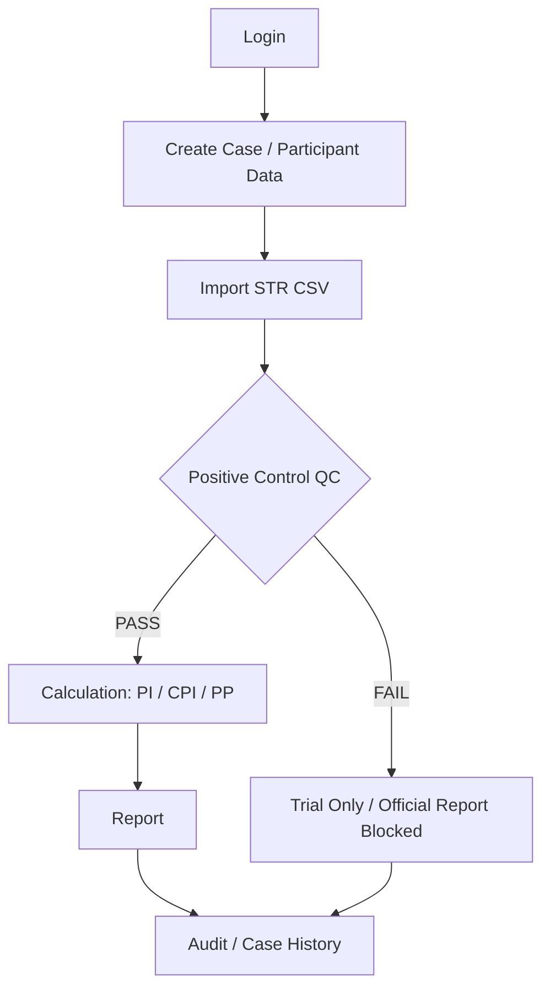

# PaternityTestSystem

以 C# / .NET 8 開發的 Windows Desktop Clinical Workflow Application，將案件處理、STR CSV 驗證、品質管制與報告流程轉為可維護的軟體服務。

> This repository is a portfolio version of a clinical workflow application. Sensitive medical data, production configuration, official report templates, and domain-specific calculation formulas have been intentionally excluded.

## Project Background

原系統使用 WPF / XAML 與 SQLite，已部署於實際工作環境進行使用者測試。本作品集精選並簡化代表性程式碼，展示資料處理、錯誤處理與業務規則的實作方式。

此版本可獨立建置為 .NET 8 類別庫；不含 WPF 畫面、資料庫存取實作及正式計算引擎，無法用來執行完整鑑定工作流程。

## Workflow

以下為原應用程式的高層流程：



## Tech Stack

| 技術 | 原系統中的用途 | 本作品集 |
| --- | --- | --- |
| C# / .NET 8 | Windows 桌面程式及服務層 | 可建置的服務類別庫 |
| WPF / XAML | 操作介面 | 架構說明 |
| SQLite / Microsoft.Data.Sqlite | 案件資料與稽核紀錄 | 架構說明；未公開 schema 或資料存取層 |
| BCrypt | 密碼驗證 | 注入使用者查詢與稽核介面的範例 |
| xUnit | 自動化驗證 | 兩個簡單測試 |
| Git | 版本管理 | 獨立初始歷史 |

## Key Features

原系統涵蓋 Case Management、STR CSV Processing、Positive Control QC、Paternity Calculation Workflow、Word Report Generation、Audit Trail 與 Case Status Protection。

公開程式碼著重 CSV 正規化、外部提供參考資料的 QC 比對、透過介面呼叫計算器的流程、檔案儲存與通用 Word 文件處理。`IMarkerPiCalculator` 只有介面，沒有任何 PI 計算實作。

## Engineering Highlights

- **QC Gate**：原系統在 business service 再次檢查 QC，FAIL 時禁止正式報告；此處保留 QC 比對範例，正式報告服務與規格未公開。
- **Data Integrity**：原系統搭配資料庫 transaction 與檔案失敗補償。作品集展示獨立 operation folder 與限定範圍的 cleanup；交易協調概念見 [architecture](docs/architecture.md)。
- **Cancelled Case Protection**：取消後保留歷史檔案，透過 domain guard 禁止重新計算、產生／開啟報告與計算核對表。
- **Selected Automated Tests**：Selected xUnit tests demonstrate CSV parsing and domain rule validation. 測試使用 Arrange / Act / Assert，範圍限於兩個示例。

## Code Highlights

Recommended Reading：

1. [GenotypeCsvParser.cs](src/Parsing/GenotypeCsvParser.cs)：CSV 欄位驗證、大小寫不敏感分組、警告／錯誤收集及同型合子正規化。
2. [CaseFileStorageService.cs](src/Storage/CaseFileStorageService.cs)：檔案複製、operation folder、路徑檢查及失敗補償。
3. [LabCaseAccessGuard.cs](src/Domain/LabCaseAccessGuard.cs)：讓業務限制能在 service / domain 層重複使用。

其他範例：[QC](src/QualityControl/PositiveControlQualityService.cs)、[計算流程](src/Calculation/PaternityCalculationService.cs)、[Word 文件](src/Reports/WordTemplateService.cs)、[登入與稽核](src/Security/AuthenticationService.cs)。

## Build / Test

安裝 .NET 8 SDK 後，於 repository 根目錄執行：

```sh
dotnet restore PaternityTestSystem.Portfolio.sln
dotnet build PaternityTestSystem.Portfolio.sln --configuration Release --no-restore
dotnet test PaternityTestSystem.Portfolio.sln --configuration Release --no-build
```

[sample_genotype.csv](samples/sample_genotype.csv) 為完全虛構資料，可用於 `GenotypeCsvParser.ParseAsync`。此類別庫沒有桌面啟動程式；計算、使用者查詢及稽核功能需要呼叫端提供介面實作。

## Screenshots

`screenshots/` 暫留空，之後僅加入經人工確認、使用虛構資料的畫面。

## Privacy

本庫不包含病人或真實案件資料、正式資料庫、內部路徑、憑證、正式 Positive Control profile、allele-frequency dataset、PI 公式、正式報告範本或原專案 Git 歷史。公開範圍與調整方式見 [publication scope](docs/publication-scope.md)。

## About Me

我關注 C# / .NET 桌面應用程式開發，以及將實際臨床作業轉換成清楚的資料驗證與業務規則。這份作品集呈現我在服務拆分、錯誤處理與檔案管理上的實作，也保留正在學習中的基礎單元測試。

GitHub：[vint822](https://github.com/vint822)
