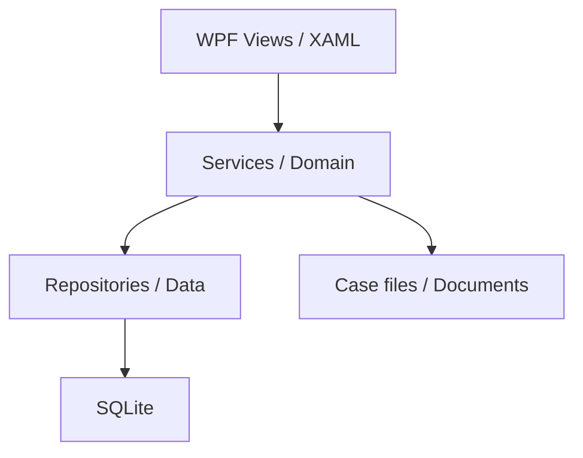
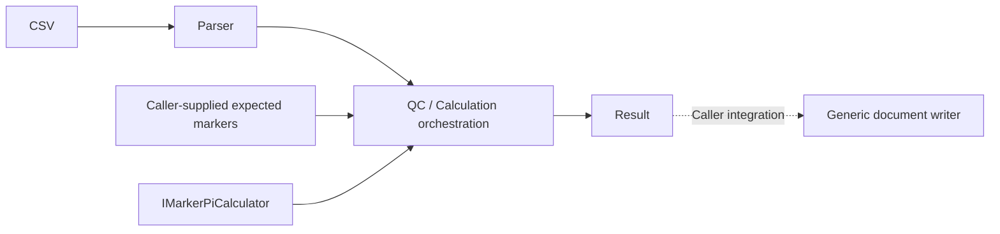

# Architecture

## Original application context



本作品集僅保留選定的 Services / Domain 及最小模型。WPF 畫面、SQLite schema、repositories、正式工作流程協調器及部署設定不在公開範圍。

## Data flow



- Parser 只解析欄位與正規化 genotype，不套用特定 assay 的 marker 過濾。
- QC 的 expected markers 必須由呼叫端提供。本庫沒有內建參考 profile。
- Calculation service 匹配 parent / child markers，呼叫計算介面並彙整 CPI。沒有介面實作、頻率資料或各 genotype 組合的公式。
- Word service 示範 ZIP 中 `word/document.xml` 的 XML 處理、跨 run placeholder replacement 與通用 marker table。它不是正式報告產生器，也不負責判定 QC 或鑑定結論。
- Authentication service 注入使用者查詢及 audit writer，回傳結果不包含密碼雜湊。本庫不提供使用者資料庫或預設帳號。

## Boundaries and integrity

`LabCaseAccessGuard` 集中表達取消案件的限制。原應用程式的 business service 會在重新計算、產生或開啟文件前呼叫 guard；原系統另於正式報告流程檢查 QC。這些完整協調服務未公開，通用文件寫入器不可視為可獨立使用的正式報告服務。

資料庫 transaction 無法自動回復檔案系統。原系統以 operation ID 區分一次操作所建立的檔案，失敗時回復資料庫並清理該次操作。作品集的 storage service 展示檔案端的責任；整合時由呼叫端處理：

```text
Create operation folders → Copy files → Persist records in transaction
                                      ├─ Success: keep operation files
                                      └─ Failure: rollback + compensate this operation
```

補償失敗必須保留警告並交由呼叫端處理；這不是跨資料庫與檔案系統的原子交易，也不涵蓋程序崩潰後的自動復原。

儲存根目錄由參數提供。路徑檢查與 operation 範圍限制降低誤刪風險，既有歷史檔案不在補償範圍。根目錄應由可信任的程序管理；路徑檢查不提供對抗其他程序同時改動檔案系統的完整隔離。

## Deliberate limits

這是供程式碼閱讀與面試討論的類別庫。兩個 xUnit 測試只示範 CSV 正規化與取消案件規則，並非完整系統驗證。範例 CSV 的 MarkerA / MarkerB / MarkerC 為虛構標記；所有正式資料與計算規則均未提供。
